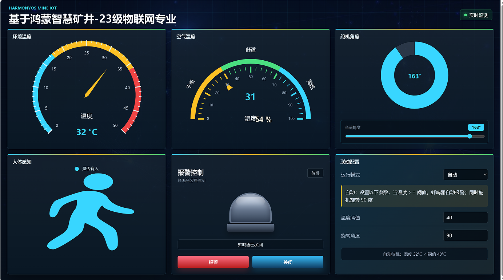

# 物联网监控项目（Java）

基于 Spring Boot、MySQL、MQTT 和 WebSocket 的物联网监控与控制项目，包含温湿度显示、人体感知、蜂鸣器报警和舵机控制页面。

## 前端展示



监控大屏包含环境温度、空气湿度、舵机角度、人体感知、蜂鸣器报警控制，以及温度阈值与舵机角度联动配置。

前端源码位于 `src/main/resources/static/`，启动后访问 `http://localhost:8080/`。实时数据与控制功能需要连接后端及 MQTT 服务。

## 项目来源

本项目基于课程项目继续开发，已保留代码中的原作者署名。
本仓库上传当前代码快照；为避免公开旧配置中的凭据，不包含原仓库的 Git 历史。

## 运行准备

- Java 21（版本要求见 `pom.xml`）。
- MySQL：创建数据库 `wlw2023`，导入 `db/iotmessage.sql`。
- MQTT Broker 和对应硬件：按实际连接配置环境变量，硬件与程序的订阅、发布主题须一致。

## 环境变量

| 变量 | 用途 | 默认值 |
| --- | --- | --- |
| `DB_URL` | MySQL JDBC 地址 | `jdbc:mysql://localhost:3306/wlw2023?useUnicode=true&characterEncoding=utf8&serverTimezone=Asia/Shanghai` |
| `DB_USERNAME` | 数据库用户名 | `root` |
| `DB_PASSWORD` | 数据库密码 | 必填 |
| `MQTT_HOST` | MQTT 地址 | `tcp://localhost:1883` |
| `MQTT_USERNAME` | MQTT 用户名 | 空 |
| `MQTT_PASSWORD` | MQTT 密码 | 空 |
| `MQTT_CLIENT_ID` | MQTT 客户端标识 | 自动生成 |
| `MQTT_SUB_TOPIC` | 订阅硬件数据的主题 | `iot/data` |
| `MQTT_PUB_TOPIC` | 发布硬件控制指令的主题 | `iot/control` |

在 IDEA 的运行配置中设置环境变量，或在 PowerShell 中设置 `$env:变量名 = "你的值"`，再启动程序。

```powershell
.\mvnw.cmd spring-boot:run
```

默认页面地址：http://localhost:8080/ 。Maven Wrapper 首次运行需要联网下载 Maven 和项目依赖；依赖版本以 `pom.xml` 为准。

本仓库不包含真实账号密码、个人简历、实习报告、本地备份或运行日志。
